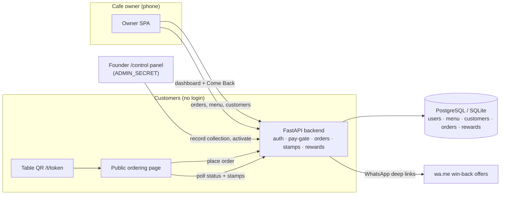

# ☕ CafeLoop — Turn One-Time Visitors into Regulars

**Designed and built by Mohammed Abdul Farhan**

CafeLoop is a cafe-retention platform for cafe owners. A cafe's biggest leak is not finding new customers — it is the first-time visitor who never comes back, because the cafe holds nothing that brings them back: no phone number, no reason, no reminder. CafeLoop plugs that leak end-to-end: customers order from a table QR, every served order automatically earns a stamp, five stamps automatically issue a free-drink reward code, and regulars who go quiet for 14+ days land on a **Come Back list** with a one-tap WhatsApp win-back offer naming their favourite item.

One plan. Everything included. No tiers, no per-seat games.

| | |
|---|---|
| **Plan** | CafeLoop Pro — **₹1,499/month** · **₹14,990/year** (2 months free) |
| **Includes** | Unlimited tables, unlimited customers, every feature |
| **Customers pay** | At the counter, as always — CafeLoop never touches customer payments |

---

## 💼 Business Impact

- **The follow-up problem, solved for cafes.** A typical cafe sees hundreds of one-time visitors a month. CafeLoop captures a name + phone number with *every* order — no app download, no customer account, no extra hardware — so the cafe finally owns a customer list it can bring back.
- **Loyalty that runs itself.** Stamps, rewards and expiry are fully automatic: the owner never hands out a paper card, never counts stamps, never argues about a lost card. Five served orders → a unique free-drink code (`CL-XXXXXX`, valid 7 days) appears on the customer's own phone.
- **Win-back on one tap.** The Come Back list surfaces regulars (≥2 visits) who have been gone ≥14 days, sorted by days absent, each with a pre-written WhatsApp offer ("Your favourite Cappuccino is waiting — 20% OFF this week"). One tap per customer, straight from the owner's phone.
- **No kitchen hardware.** Small cafes cannot afford kitchen display systems. Orders land live on the owner's phone instead — with a NEW-order alert and sound — and the owner accepts with a preparation time (10/15/20/30 min) that the *customer watches live* on their own phone. Fewer "how much longer?" questions, zero hardware cost.
- **Honest numbers.** The dashboard counts revenue only from orders the owner marks paid at the counter, shows repeat-customer % from real visit data, and ranks the week's top items — the numbers an owner actually runs a cafe on.

## ✨ Highlights

- **Table QR ordering** — one public link per cafe (`/t/<token>`), table selectable, animated menu in 10 categories, 35-item Indian cafe menu seeded out of the box.
- **Live order tracking for customers** — Placed → Accepted (ready in ~N min) → Preparing → Served, polling every few seconds; owner delays (+5 min) reflect on the customer's screen instantly.
- **Automatic stamp engine** — exactly one stamp per served order (idempotent, impossible to double-award), card resets at 5 with lifetime stats preserved.
- **Pay-first subscription gate** — non-active owners can reach only details/plans/payment/logout; every other owner API returns `402`. Activation is recorded by the founder after in-person collection via a hidden `/control` panel; public customer pages are never gated.
- **Face-scan activation** — when the founder visits in person, his face scan on the owner's own phone (on-device match + server-chosen liveness beat, single-use challenge) records the payment and unlocks the app on the spot.
- **Details-once onboarding** — Google sign-in (born verified) or email + OTP; cafe & owner details are asked exactly once per account and never re-asked on re-login.
- **Tenant isolation** — every query is scoped per cafe; one cafe can never see another's orders, customers, menu or rewards.
- **Mango-yellow design system** — warm cream base, sunny yellow → orange → red appetite palette, chunky display type, motion everywhere (floating beans, marquee, pop-in stamps, confetti reward reveals, counting dashboard numbers), mobile-first.

## 🧱 Tech Stack

| Layer | Technology |
|---|---|
| Backend | Python 3.12 · FastAPI · SQLAlchemy 2 · Pydantic |
| Database | PostgreSQL (Neon) in production via `DATABASE_URL` · SQLite for local dev |
| Auth | Google OAuth 2.0 / OIDC · email + OTP (hashed codes, 10-min TTL) · bcrypt passwords · signed session cookies |
| Frontend | Single-file SPAs (owner app + public ordering page) · vanilla JS · CSS animations (60fps transforms) |
| Payments (owner plan) | UPI QR + founder-side activation from a hidden admin panel |
| Testing | pytest · 41 automated tests + a scripted live end-to-end boot check |
| Hosting | Render (uvicorn) · `render.yaml` included |

## 🏗️ Architecture



**The automation chain (all server-side, one transaction each):**
place order → order row + customer upsert → owner accepts (status + ETA stored) → customer polls the same ETA → **SERVED** → stamp +1, visits +1, favourite recomputed → at 5 stamps a reward code is issued and the card resets → owner redeems the code once → quiet regulars surface on the Come Back list → dashboard aggregates it all from the same rows.

## 🔓 Face-scan activation

CafeLoop's founder collects plan payments in person. When he is standing in the cafe, the owner taps **Pay — Unlock by Face Scan** on the locked payment screen: the phone's camera matches Farhan's face — on the device, with a locally served face-recognition model (vendored, no CDN; only numeric descriptors are ever stored, never a photo) — against the template he enrolled once from his `/control` panel, with a liveness beat (a blink or head turn the server picks at random) against photo spoofing. The server issues a single-use, 120-second challenge and, only on a verified pass, records the activation itself (method `face_unlock`, amount computed server-side from the plan) — the app unlocks on the spot, for the period the owner selected on the pay screen. Five failed attempts lock face unlock for that cafe for 15 minutes, and a cafe switched off from Control stays off. Manual activation from `/control` remains the fallback.

## 🚀 Run it locally

```bash
cd backend
python -m venv .venv && .venv/bin/pip install -r requirements.txt
.venv/bin/uvicorn main:app --host 127.0.0.1 --port 8000
```

Open `http://127.0.0.1:8000` — sign up, verify (set `DEV_OTP_ECHO=1` locally to see codes in the log/response), save details, then activate from `/control` (set `ADMIN_SECRET` first).

### Environment variables

| Variable | Purpose |
|---|---|
| `DATABASE_URL` | Postgres connection string (production). Defaults to local SQLite. |
| `SECRET_KEY` | Signs session cookies. |
| `ADMIN_SECRET` | Enables the hidden `/control` activation panel. Unset → the panel does not exist. |
| `GOOGLE_CLIENT_ID` / `GOOGLE_CLIENT_SECRET` | Enables Google sign-in. |
| `SMTP_HOST` / `SMTP_PORT` / `SMTP_USER` / `SMTP_PASS` / `SMTP_FROM` | Emails OTP / reset codes. Unset → codes are only logged with `DEV_OTP_ECHO=1`. |
| `APP_BASE_URL` | Public base URL for links (defaults to the request host). |

## ✅ Testing

```bash
python -m pytest tests/ -q
```

**41 tests, all passing**, covering: signup/OTP/details-once (re-login never re-asks), Google sign-in, password reset, the pay-gate (402s), exactly-one-plan pricing (₹1,499/₹14,990), public ordering creating customers, server-side totals, accept-with-ETA visible on the public order-status API, no backwards status moves, serve → exactly one stamp, 5th stamp → reward valid 7 days, redeem-once, Come Back math (≥2 visits, ≥14 days), dashboard math (revenue = paid-marked orders only), tenant isolation, menu CRUD persisting to the public page, and face unlock (enrollment + validation, challenge expiry/single-use, bad-distance and missing-liveness refusals, verified scan activating for the pay-screen period, 5-failure lockout, switch-off override). A scripted live boot check additionally runs the full chain against a real uvicorn server (signup → activate → order → accept → serve → reward → redeem → comeback → dashboard), and a second one walks the face-unlock chain (template enrollment → signup → OTP → details → 402 gate → face verify → active → re-login with details intact).

## 📄 License

Proprietary — © Mohammed Abdul Farhan. All rights reserved.
